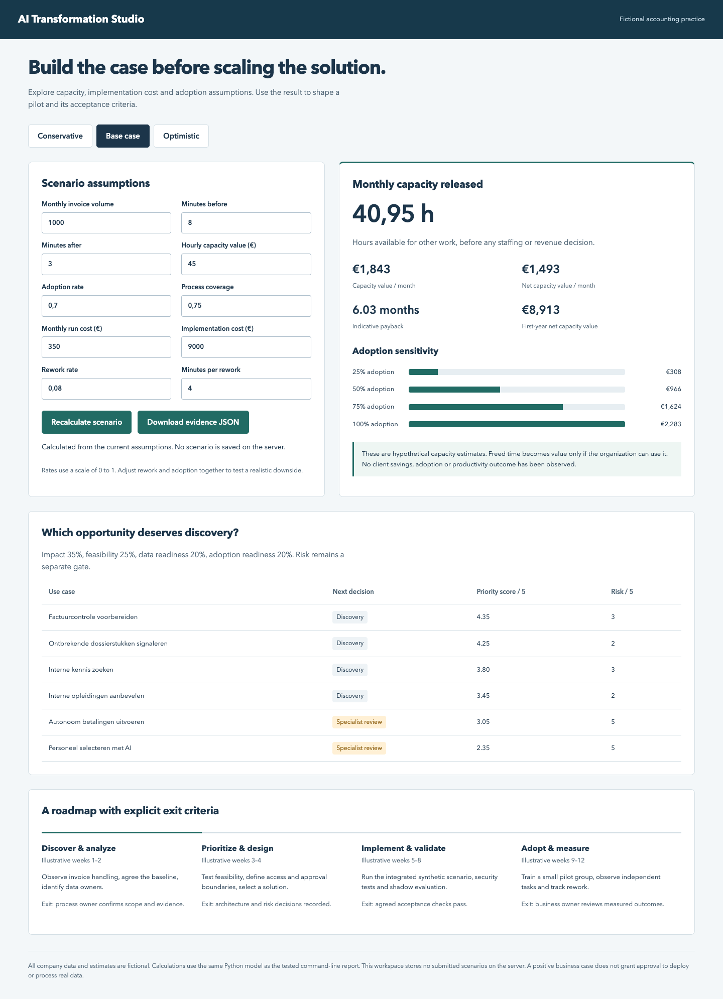

# AI Transformation Playbook

**Stack:** Python standard library · authored HTML workspace · optional Playwright/Chrome verification. [Portfolio v1.0 release scope](docs/releases/portfolio-v1.0.0.md).

One fictional accounting practice, six independently runnable engineering components. Follow the case from process discovery and a transparent business case to invoice review, controlled AI tool proposals, authorized knowledge access, evaluation and a restricted Microsoft connector artifact.

**Career launch:** [recruiter brief](portfolio/career-launch/RECRUITER-BRIEF.md) · [career materials and ownership plan](portfolio/career-launch/README.md).

**Start here:** [case study and architecture](portfolio/SHOWCASE.md) · [v1.0 publication and final handover](portfolio/release-2026-11-01/FINAL-HANDOVER.md) · [recruiter and interview handover](portfolio/release-2026-10-31/HANDOVER.md) · [hands-on ownership exercises](portfolio/release-2026-10-30/LEARNING.md).

This is a synthetic consulting demonstration. Portfolio v1.0 is public on the validated `main` branches, with annotated `portfolio-v1.0.0` releases and independent public-access checks. Azure inference/OCR and full Copilot Studio runtime are not verified. Personal proficiency and client outcomes are not established by these repositories.

Een praktisch consultantdossier voor een **fictief accountancykantoor**. Je ontdekt procesproblemen, selecteert een verantwoorde AI-toepassing, maakt de businesscase, organiseert een pilot en helpt medewerkers ermee werken. De zes technische portfolio-repo's krijgen hiermee een bedrijfscontext.

## Portfolio update — 29 October 2026

Run `python3 -m consulting.server` and open <http://127.0.0.1:8086> for editable scenario assumptions, adoption sensitivity, risk-gated prioritization and a delivery roadmap. The calculator uses the tested Python model; every figure is hypothetical.

Run `python3 -m integration.scenario --root ..` after independently installing the five sibling API repositories. It verifies the full local HTTP scenario using synthetic data, a fixture planner and mock sinks. The default uses no model. An [opt-in genuine local Qwen run](portfolio/integration-local-model-result.json) also passed all 27 checks; no paid cloud provisioning occurs.

[Portfolio audit](portfolio/AUDIT.md) · [Completed work and evidence](portfolio/REPORT.md) · [Integration instructions](integration/README.md) · [Executive brief](portfolio/EXECUTIVE-BRIEF.md) · [Interview and learning exercises](portfolio/INTERVIEW.md)



Dit is een uitgewerkte oefencase met invulbare werkdocumenten. Er heeft geen opdracht bij Titeca of een andere klant plaatsgevonden. Kosten, volumes, beschikbaarheid van stakeholders en beoogde effecten zijn expliciete scenarioaannames. Geen claim op gerealiseerde ROI, juridische conformiteit of persoonlijke beheersing.

## Uitvoeren

Geen externe dependencies; getest met Python 3.13.

```bash
python3 -m unittest discover -s tests -v
python3 -m consulting.business_case
```

De CLI verwerkt [drie scenario's](data/scenarios.json) en [zes use-cases](data/use-cases.csv) tot [het reproduceerbare rapport](evidence/business-case.json). De berekening telt adoptie, procesdekking, herwerk, uurwaarde en gebruikskosten mee. Vrijgekomen capaciteit is geen automatisch gerealiseerde cashbesparing.

## Werkvolgorde

1. [Discovery, workshop en proces](docs/01-discovery-process.md)
2. [Requirements, acceptatie en verantwoordelijkheden](docs/02-delivery-contract.md)
3. [Businesscase, prioritering en keuzes](docs/03-business-case-decisions.md)
4. [Privacy, security en risicobeoordeling](docs/04-risk-governance.md)
5. [Pilot, opleiding, adoptie en beheer](docs/05-pilot-adoption.md)
6. [Zes weken leren en 30 vaardigheden toetsen](docs/06-learning-roadmap.md)
7. [Demo, interview en eerlijke positionering](docs/07-interview-evidence.md)
8. [Actuele certificaatkeuzes](docs/08-certifications.md)

## De zes repo's

| Repo | Bewijs dat je ermee onderzoekt |
|---|---|
| [Accounting Copilot](https://github.com/phlppgdfry/enterprise-ai-accounting-copilot) | Factuurcontrole, menselijke review, betrouwbare integratie |
| [Workflow Platform](https://github.com/phlppgdfry/agentic-workflow-platform) | Persistente stappen, toolcontracten, retries, goedkeuring |
| [Evals & Governance](https://github.com/phlppgdfry/enterprise-ai-evals-governance) | Releasecriteria, negatieve controles, traceerbare resultaten |
| [Knowledge Assistant](https://github.com/phlppgdfry/azure-ai-rag-knowledge-assistant) | Retrieval, toegangsfilters, bronnen en abstention |
| [Copilot Studio Automation](https://github.com/phlppgdfry/microsoft-copilot-studio-automation) | Smalle agentconnector en afzonderlijk akkoord |
| Deze repo | Businessanalyse, keuzes, adoptie en leren |

De zes repo's zijn publiek toegankelijk. Ze delen een casusthema maar zijn zelfstandig uitvoerbaar; de optionele lokale integratierunner verbindt vijf API's met deze businesscase, zonder clouddeployment.

## Kwaliteitslat

De kandidaat kan iedere claim herleiden naar een bestand, uitvoerbare demo, test en eigen oefening. Een tabel met gewenste KPI's is geen meting. Een geslaagde fixture-evaluatie is geen bewijs dat een echt model betrouwbaar is. De leertracker begint daarom op **niet getoetst**.
