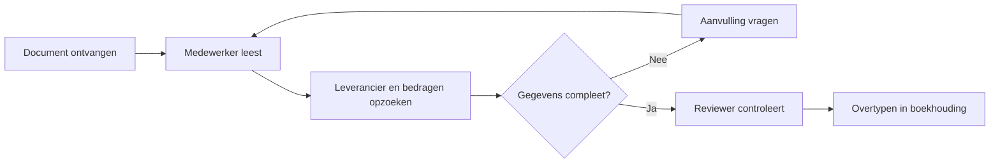
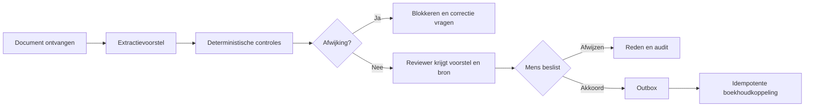

# Discovery en procesontwerp

## Uitgewerkte oefencase

Het fictieve kantoor verwerkt in het basisscenario 1.000 facturen per maand. Medewerkers lezen de factuur, zoeken leveranciersgegevens, controleren bedragen en vragen een reviewer om akkoord. Verkeerde of ontbrekende gegevens leiden tot extra e-mails. De veronderstelling is dat voorbereiding vaak acht minuten kost; dit is nog geen gemeten baseline.

**Doel:** minder voorbereidend zoek- en controlewerk, met behoud van menselijke beslissingsbevoegdheid. **Eerste scope:** synthetische EUR-facturen en dossierstukken. **Buiten de pilot:** betalingen, fiscale conclusies, personeelsselectie en automatische wijziging van stamgegevens.

## Workshop van 90 minuten

| Tijd | Werkvorm | Tastbaar resultaat |
|---|---|---|
| 0–10 | Proceseigenaar vertelt het gewenste resultaat | Eén toetsbare probleemzin |
| 10–30 | Medewerker doorloopt drie geanonimiseerde of synthetische gevallen | Stappen, uitzonderingen, wachttijden |
| 30–45 | Data/IT brengt systemen, sleutels en rechten in kaart | Datastromen en eigenaars |
| 45–60 | Groep vergelijkt regels, automatisatie en AI | Eerste oplossingsopties |
| 60–75 | Reviewer/privacy/security onderzoeken foutpaden | Risico's en stopcriteria |
| 75–90 | Product Owner stelt scope en meetplan vast | Besluitlog en toegewezen acties |

Vraag niet alleen 'waar kunnen we AI gebruiken?'. Vraag: welke beslissing wordt genomen, wat gebeurt er bij twijfel, wie corrigeert de fout en waar blijkt uit dat het probleem groot genoeg is? Observeer echt werk; een stakeholderinschatting is een hypothese tot je meet.

## Huidig proces

## Voorgesteld proces

Dit zijn leesbare procesdiagrammen, geen uitvoerbare BPMN-bestanden. Voor formele BPMN leg je ook lanes, message events, gateways, timers en foutafhandeling vast en valideer je het model met betrokken medewerkers.

## Invulbaar observatieblad

| Veld | Oefeninvulling | Zelf verifiëren |
|---|---|---|
| Trigger | Factuur komt binnen | Alle kanalen inventariseren |
| Procesowner | Finance operations lead | Naam en mandaat bevestigen |
| Doorlooptijd | Onbekend | Start/eindmoment en wachttijd meten |
| Behandeltijd | Hypothese 8 minuten | Gestratificeerde steekproef |
| Uitzondering | Onbekende leverancier | Volume en afhandelpad meten |
| Gevolg fout | Verkeerde boeking | Herstelkosten en ernst vaststellen |
| System of record | Nog te bepalen ERP | API, rechten en sleutelcontract bevestigen |

Neem eenvoudige én moeilijke gevallen op in de baseline. Leg de steekproefselectie vast om te voorkomen dat een pilot alleen makkelijke facturen laat zien.
