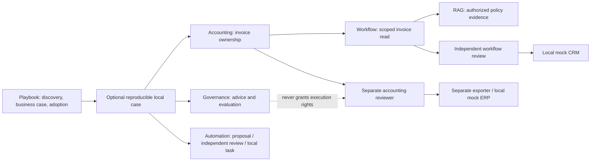

# Portfolio engineering report — 29 October 2026

This report covers completed local changes on six `portfolio/enterprise-quality-2026-10-29` branches. Existing repositories and valuable implementations were preserved. No branch has been pushed, repository made public or paid resource provisioned. The code remains a reference portfolio with synthetic data, not production software or evidence of client delivery.

## A. Baseline audit

All six local repositories were clean on `main` with the requested owner/remotes. Baseline tests were reproduced: **101 passed** across six suites. Strengths included exact accounting validation, server-controlled roles, tenant boundaries, durable workflow checkpoints, outbox idempotency, RAG access trimming, evaluation gates, connector separation and transparent business assumptions. The main gaps were disconnected demonstrations, fixture-only tools, absent workflow/consulting interfaces, no actual portfolio evaluation targets and Azure stale-chunk handling.

The [detailed audit](AUDIT.md) and [delivery backlog status](BACKLOG.md) distinguishes defects from enhancements, including per-repository enterprise readiness and evidence. [baseline.json](baseline.json) records starting commits, branches, remotes, package consistency checks and exact test output. Scores were deliberately omitted rather than inflating maturity.

## B. Completed improvements

| Repository | Functional work | Supporting evidence |
|---|---|---|
| Accounting Copilot | PDF/JSON source preview; explicit offline JSON import; missing-field/provider-confidence review signals; strict boolean approvals; safe malformed credentials; bounded requests, safe errors and request IDs; source and retrieved-detail clearing on identity switch | 35 tests; real browser source→review→export; authenticated tenant/role tests; optional Azure contracts remain mocked |
| Workflow Platform | Read-only invoice/RAG HTTP tools with server-owned customer bindings; wrong-scope/redirect/error/size rejection; persisted cancellation fences active workers and pending delivery; execution inspector with checkpoints, receipts, approvals and timeline | 44 tests; actual HTTP integration; real local Qwen tool calling; browser self-approval denial, independent approval and completed mock delivery |
| Evals & Governance | Reusable adapters observe actual RAG/workflow APIs; authored RAG security dataset; executed-run dashboard and positive/negative controls; safe request boundary; OpenAPI drift check | 29 tests; RAG 4/4 and workflow 2/2 API cases in integration report; negative fixture deliberately blocks release |
| Azure RAG | Knowledge/source UI; document-level precision/recall/MRR/nDCG benchmark; explicit Azure parent replacement/deletion with bounded batches and complete acknowledgement checks; finite embedding checks; request hardening | 21 tests; six-case local benchmark; actual finance/HR browser denial; Azure lifecycle uses contract doubles, not live mutations |
| Microsoft Automation | Strict approval booleans; safe credentials/errors/request limits; parameterized connector Swagger/API-properties packaging; least-privilege artifact tests; actual Microsoft-imported connector and exported unmanaged solution/source | 17 tests; real local HTTP proposal/review/execute; actual tenant artifact import/export |
| Transformation Playbook | Interactive capacity assumptions/sensitivity, downloadable calculation evidence, risk-gated prioritization and roadmap; actual five-API runner; repeatable repository/browser checks; executive brief, audit, evidence and interview exercises | 9 tests; 27 integration checks; 26 browser checks across five interfaces |

Each API gets generated request IDs, metadata-only request logs and byte-counted body limits. Four new console HTML assets are included in distributable wheels; all five API wheels were built and inspected. Packaging initially failed with `--no-build-isolation` in four environments lacking setuptools; normal isolated wheel builds succeeded. No application dependency change was required.

## C. Architecture and contracts



No shared database, mandatory central package or distributed transaction was introduced. The optional runner starts each independently installed API. Workflow reads use fixed origins and tenant/customer bindings; model text cannot choose destinations, credentials or invoice IDs. Retrieved source text is evidence and cannot change the server's approval rule. Separate approvals do not confer cross-service authority.

See [integration instructions](../integration/README.md) and each application's `docs/portfolio-integration.md`/OpenAPI snapshot. The existing bounded state machine was retained after reviewing current Microsoft Agent Framework and LangGraph documentation through Context7. MCP and multiple agents were deferred because no concrete requirement justified them.

## D. Runnable demonstrations

From this repository, after installing the five sibling APIs independently:

```bash
python3 -m integration.scenario --root ..
python3 -m consulting.server
```

The first command performs the synthetic HTTP scenario and stops its own temporary services. Add `--serve --session-file /tmp/portfolio-session.json` to inspect them interactively. The second starts the consulting workspace at `http://127.0.0.1:8086`. The service URLs printed by the runner expose `/console` for accounting/workflow/RAG/governance and `/docs` for automation.

Individual READMEs retain standalone setup, tests, demo and Docker recipes. The integrated case uses explicit invoice JSON, local extractive retrieval, a fixture planner, scripted reviewer identities and local sinks. **It does not perform OCR, genuine inference or observed human UAT.** The provider adapters make actual Azure REST requests only when separately configured; their existing/new contract tests do not prove live quality. A separate opt-in Ollama adapter was genuinely executed with the installed local Qwen model, including reported tokens, measured planning latency and independent approval; see workflow `evidence/local-model-run.json` and `docs/local-inference.md`. This is one bounded model planning call, not adaptive replanning or a general quality benchmark.

## E. Technical evidence

| Suite | Baseline | Final local result |
|---|---:|---:|
| Accounting | 29 | 35 passed |
| Workflow | 25 | 44 passed |
| Evals | 23 | 29 passed |
| RAG | 12 | 21 passed |
| Microsoft automation | 6 | 17 passed |
| Playbook | 6 | 9 passed |
| Total | 101 | **155 passed** |

Additional evidence:

- Genuine local Qwen tool-call workflow: native model calls, validated/persisted plan, approval wait and completed mock case; no Azure or paid inference claim. The [genuine-model integration report](integration-local-model-result.json) passes the same 27 checks using actual invoice/policy HTTP tools and records the native model plan, tokens, latency and event history.

- [Actual HTTP integration](integration-result.json): 27 passed checks, complete accounting audit, actual API evaluation reports and business assumptions.
- [Browser QA report](QA.md) and [executed checks](browser-qa.json): 26 passed checks, Chrome via the existing Playwright installation, 1440×1000 and 390×844, no unexpected console/runtime errors. Intentional 403 denial responses are recorded separately.
- [Exact verification commands/output](verification.json): package consistency, OpenAPI drift, required demos, positive gate exit 0, negative gate expected exit 1, and unchanged calculated business-case evidence.
- [Wheel manifests](wheel-builds.json): five built API packages, four applicable console assets present. Wheel construction is not a deployed-container test.
- Per-repository `evidence/dependency-audit.json`: all five lockfiles scanned against current advisory data, no known advisories found. Playbook has no third-party runtime dependencies.
- Per-repository `evidence/FEATURES.md`, new JUnit XML and `verification-2026-10-29.json`: feature-level status and executed evidence. Original historical evidence remains intact.

Five pytest suites retain an upstream Starlette/httpx TestClient deprecation warning. A duplicate cache header regression was caught and fixed. Browser attempts caught repeated synthetic IDs and a detail-loading/role-switch timing issue; the corrected repeatable flow passed. Those failed attempts were not counted as passing evidence. Docker/container builds, remote Actions runs, load tests, other browsers, assistive technology and live cloud quality were **not rerun/verified** in this change. The manual private integration workflow is authored, not remotely executed.

## F. Security and remaining risk

Addressed: non-ASCII credential exceptions; permissive boolean approval input; reflected validation values; unbounded request bodies; missing request correlation; unsafe dependency responses; stale display on identity switch; cancellation races; missing actual cross-service authorization/idempotency evidence; stale Azure parent-chunk replacement logic.

Still required before a real pilot: Entra issuer/audience/scope validation, gateway rate/concurrency limits and TLS, credential rotation, approved hosting, independent security review, source-file scanning/retention, immutable audit storage if required, operational alerts/backups, and representative model evaluation. SQLite and process-local admission control remain single-host choices. Cancellation does not kill an in-progress network call or undo effects; fencing prevents its stale checkpoint from committing.

Azure replacement is not atomic and can leave an unavailable document after a failed upload. Search visibility and ACL changes need maintenance gating or index-version rollout; do not claim instant cloud revocation. Evaluation string/citation checks do not establish semantic truth, comprehensive injection resistance or legal compliance. No client data, secrets or public access were introduced.

## G. Microsoft readiness

Read-only live checks found a reachable existing Dataverse development environment through the current PAC profile. The sandbox's initial keychain failure disappeared outside the sandbox. Azure's cached account was misleading: live resource inventory failed with `SubscriptionNotFound` for the selected subscription. No account was switched and no Azure resource created. [cloud-readiness.json](cloud-readiness.json) records the sanitized status.

Connector package generation and Microsoft artifact acceptance are verified. The new isolated `PhlppPortfolioApproval` solution was imported, the restricted connector created and listed, and a real unmanaged solution exported/unpacked and successfully reimported into its own isolated solution. The exported ZIP and sanitized evidence are retained in the Microsoft repository; see `solution/README.md` and `evidence/tenant-artifact-2026-10-29.json`. The connector has no configured production backend/connection: it uses a reserved example host for artifact acceptance. No Copilot conversation, Power Automate approval run, Dataverse business write, Graph call or deployed Azure inference is claimed. The new solution/connector remain isolated in that development environment; no existing solution was overwritten. Tenant artifact acceptance and working application integration are separate evidence levels.

Next external steps: select an approved HTTPS host, deploy a separately authenticated API, choose/approve the target environment and DLP policy, establish agent-only connection credentials, import/configure the actual agent/flow and record operation IDs plus denied privilege tests. Existing licences and resource configuration must be assessed; no new paid infrastructure is authorized by this report.

## H. GitHub presentation

All six READMEs now link current behavior, evidence and integration boundaries. Five include authentic implemented-interface screenshots. MIT licensing is preserved. CI adds useful drift/package/connector/retrieval checks without paid model calls; the optional cross-repository workflow requires explicit dispatch and a private-read token scoped to these repositories.

[github-presentation.json](github-presentation.json) contains the applied descriptions/topics; [before/after verification](github-metadata-result.json) records the requested metadata changes. Descriptions use claims supported by the existing implementations. All six remote repositories were rechecked as private. Source branches remain local and unpushed. After authorized publication of the branches, pin accounting, workflow and playbook first; order the other three as quality, knowledge and Microsoft integration. Give private reviewers access rather than changing visibility.

## I. Interview preparation

Use [INTERVIEW.md](INTERVIEW.md) to explain actual code choices: outbox boundaries, scope validation, cancellation/fencing, lexical versus hybrid retrieval, metric limitations, connector permissions and capacity-versus-cash reasoning. Demonstrate a denial and a recovery, not only a successful path. Existing learning guides remain useful. Candidate competency is unassessed until the exercises are independently completed.

## J. Remaining skills and work

The [learning matrix](INTERVIEW.md#skills-gaps-and-practical-exercises) maps each gap to a repository, source paths, practical exercise, objective and current Microsoft certification topic. It covers real extraction calibration, model/tool debugging, concurrent workers, enterprise identity, retrieval failure analysis, evaluation design, tenant ALM/DLP, operations, discovery, business-case reasoning and adoption measurement.

The executive brief includes traceable assumptions, risk/acceptance gates, owners, adoption/KPIs and presentation content. An editable PPTX remains unproduced: the installed [Presentations SKILL.md](/Users/philippegodfroy/.codex/plugins/cache/openai-primary-runtime/presentations/26.904.11930/skills/presentations/SKILL.md) explicitly requires “Call `load_workspace_dependencies`.” That tool is not exposed in this session; the executive brief is not described as a finished deck. Other open work includes genuine Azure quality benchmarks, a real externally hosted connector/agent/flow, production identity/operations, and user-led adoption evidence. Those limitations remain explicit rather than counting the entire mission as production-complete.
