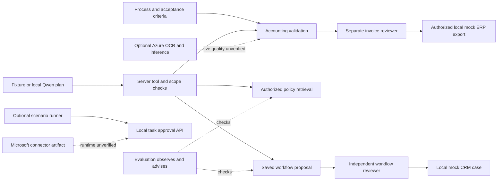

# Philippe Godfroy — AI transformation & business technology

I am transitioning toward business analysis, AI implementation and product-focused technology roles. This independent portfolio uses substantial AI-assisted development; I am building the proficiency to explain, modify and troubleshoot the work myself.

## Executive overview

A fictional accounting practice needs to review invoices, find the right policy and keep approval responsibility clear. This case connects a business process and transparent assumptions to six working components: invoice validation, controlled AI tool proposals, authorized knowledge retrieval, independent review, evaluation and a Microsoft connector artifact. The public milestone includes retained tests, hosted CI, local demonstrations and genuine local-Qwen evidence. Invoice fields and business effects are synthetic; the default demo calls no model. Azure inference/OCR and full Copilot Studio runtime remain unverified. It demonstrates inspectable project decisions; it establishes neither client outcomes nor independently assessed personal expertise.

**Choose your route:** [60-second recruiter brief](career-launch/RECRUITER-BRIEF.md) · [run the demo](#demonstration) · [inspect technical evidence](#engineering-evidence) · [career and ownership materials](career-launch/README.md).

## Business challenge

Invoice review combines repeated checks with accountable decisions. Missing fields, duplicates, policy exceptions and handoffs can create rework or an inappropriate export. A useful solution must show the source, explain exceptions, keep the reviewer independent and leave a trace of what happened. People also need training, acceptance criteria and a way to report errors. This fictional scenario provides a place to examine those needs without claiming a real accounting engagement.

## Proposed solution

| Responsibility | Component and inspectable capability |
|---|---|
| Discover and prioritize | [Transformation Playbook](https://github.com/phlppgdfry/ai-transformation-playbook): process, requirements, risk, adoption and a hypothetical capacity model |
| Validate and execute | [Accounting Copilot](https://github.com/phlppgdfry/enterprise-ai-accounting-copilot): exact amounts, duplicates, separate review, audit and local mock ERP export |
| Prepare a proposal | [Workflow Platform](https://github.com/phlppgdfry/agentic-workflow-platform): bounded tool plans, saved progress, real invoice/policy HTTP reads and independent approval |
| Retrieve permitted sources | [Knowledge Assistant](https://github.com/phlppgdfry/azure-ai-rag-knowledge-assistant): access filtering before local search and source extracts; optional Azure adapters |
| Inspect quality and controls | [Evals & Governance](https://github.com/phlppgdfry/enterprise-ai-evals-governance): executed positive/negative checks, compatible baselines and advisory policy gates |
| Demonstrate Microsoft integration boundaries | [Microsoft Automation](https://github.com/phlppgdfry/microsoft-copilot-studio-automation): proposal/status connector artifact and a separate local review/execution API |

## Architecture

Services own separate state and authority. A model proposes; the server checks permissions and arguments. Workflow approval does not approve an invoice. Evaluation advice never grants execution rights. Microsoft cloud runtime and Azure quality are outside the verified local scenario. [System map, workflow and screenshot gallery](career-launch/assets/README.md) · [architecture decisions](release-2026-10-30/STORY.md).

## Demonstration

1. **See:** browse the [actual screenshot gallery](career-launch/assets/README.md) or inspect a [three-minute recording script](career-launch/DEMO-SCRIPT.md). A new finished video has not been recorded.
2. **Run:** install the five sibling APIs using their independent READMEs, then run `python3 -m integration.scenario --root ..` from this repository. It starts temporary local services and runs the deterministic scenario. [Exact setup and cleanup](../integration/README.md).
3. **Review:** use the [recording guide](career-launch/RECORDING-GUIDE.md) to open the calculator, invoice review, tool receipts and evaluation controls. The optional installed-Qwen mode is labelled separately; a provider failure is never presented as a fixture success.

## Engineering evidence

The current public repositories and their main CI were checked on 5 November 2026: [baseline snapshot](career-launch/evidence/baseline.json). The career-launch materials are merged and the bilingual website case is live: [production report and verification](career-launch/FINAL-REPORT.md). The November 5 snapshot remains historical evidence.

The released implementation retains [172 repository-test results](release-2026-10-31/repository-checks/verification.json), five clean-install records in the API repositories, [27 deterministic checks](release-2026-10-31/deterministic.json), [27 genuine local-Qwen checks](release-2026-10-31/local-inference.json) and [26 local browser checks](release-2026-10-31/browser/browser-qa.json). These are historical executed records, not a newly claimed rerun. [Publication, release URLs and limitations](release-2026-11-01/FINAL-HANDOVER.md).

## Business impact hypothesis

Potential benefits are less repeated handling, clearer exception routing and more traceable review. The [business case](../docs/03-business-case-decisions.md) exposes assumptions for volume, adoption, coverage, rework and cost. No client savings or adoption result was observed. A pilot would compare similar tasks before and after: handling time, rework, errors, reviewer completion, actual usage and total operating cost. Freed capacity only becomes a financial benefit if the organization can use it productively.

## My contribution and developing ownership

The portfolio direction connects business questions to technical artifacts. Requirements, architecture, implementation, tests and documentation were developed with substantial AI assistance. The repository evidence shows that those artifacts and checks exist; it does not establish that I independently authored every decision or can reproduce every change without help. I bring foundational programming logic and a focus on structured business-technology problem solving, while developing deeper implementation skill.

The next evidence of personal ownership is practical: explain one boundary, trace a request, diagnose a failure and make a reviewed change without generated assistance. [14-day ownership plan](career-launch/OWNERSHIP-PLAN.md) · [interview preparation](career-launch/INTERVIEW-PREP.md).

## Next steps

Record the existing demonstration, review the website integration, complete the ownership exercises and tailor applications toward business/functional analysis, AI implementation and technical product analysis. Senior leadership is a long-term direction requiring experience, not a current qualification. [Career positioning](career-launch/CAREER-POSITIONING.md) · [human action checklist](career-launch/FINAL-CHECKLIST.md). No runtime expansion is needed for this presentation phase.
