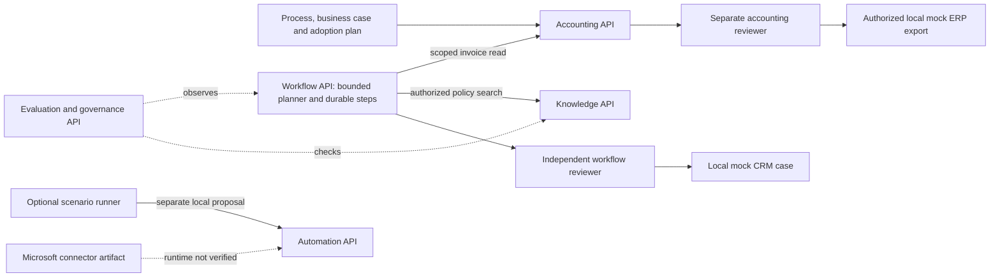
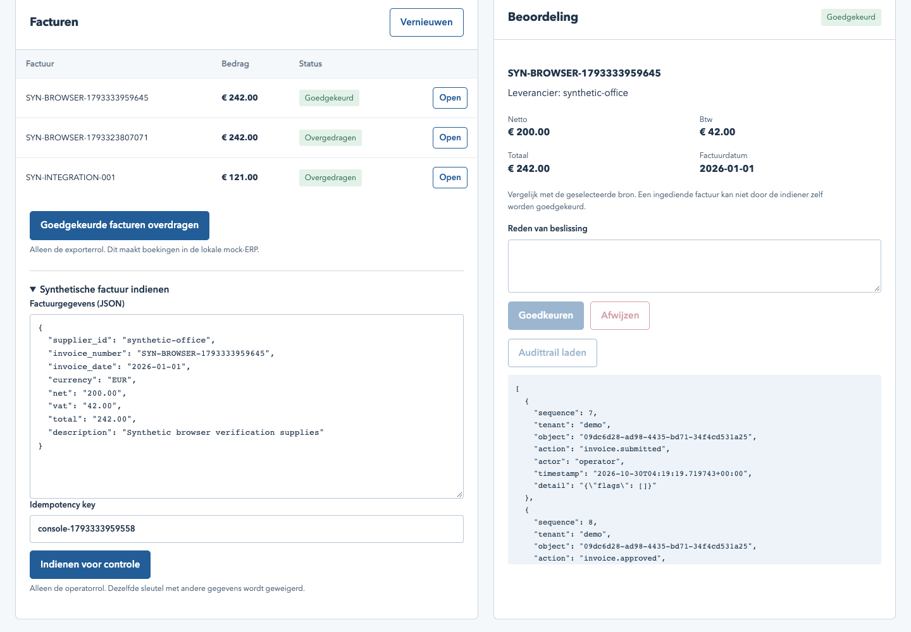

# Enterprise AI consulting case study

A fictional accounting practice wants to reduce invoice-review friction while preserving human authority and traceable decisions. This portfolio connects business analysis to working local software. It is a demonstration case, with synthetic records and hypothetical capacity estimates, not client delivery or measured savings.

## Follow the case

Discover the process → agree requirements and acceptance → build controlled automation → retrieve authorized policy evidence → obtain independent approval → evaluate behavior → plan adoption and measure a pilot.

| Component | Business responsibility | Inspect the release branch |
|---|---|---|
| Transformation Playbook | Process, assumptions, prioritization, adoption and benefits measurement | [Repository](https://github.com/phlppgdfry/ai-transformation-playbook) · [review branch](https://github.com/phlppgdfry/ai-transformation-playbook/tree/portfolio/enterprise-quality-2026-10-29) |
| Accounting Copilot | Validate invoices, separate reviewer authority and export to a local mock ERP | [Repository](https://github.com/phlppgdfry/enterprise-ai-accounting-copilot) · [review branch](https://github.com/phlppgdfry/enterprise-ai-accounting-copilot/tree/portfolio/enterprise-quality-2026-10-29) |
| Agentic Workflow Platform | Bound a model's tool proposals, persist steps and require independent approval | [Repository](https://github.com/phlppgdfry/agentic-workflow-platform) · [review branch](https://github.com/phlppgdfry/agentic-workflow-platform/tree/portfolio/enterprise-quality-2026-10-29) |
| Knowledge Assistant | Retrieve permitted policy sources before generating an answer | [Repository](https://github.com/phlppgdfry/azure-ai-rag-knowledge-assistant) · [review branch](https://github.com/phlppgdfry/azure-ai-rag-knowledge-assistant/tree/portfolio/enterprise-quality-2026-10-29) |
| Evals & Governance | Observe API behavior, apply explicit gates and retain positive/negative evidence | [Repository](https://github.com/phlppgdfry/enterprise-ai-evals-governance) · [review branch](https://github.com/phlppgdfry/enterprise-ai-evals-governance/tree/portfolio/enterprise-quality-2026-10-29) |
| Microsoft Automation | Restrict an agent connector to proposals/status; separate review and execution | [Repository](https://github.com/phlppgdfry/microsoft-copilot-studio-automation) · [review branch](https://github.com/phlppgdfry/microsoft-copilot-studio-automation/tree/portfolio/enterprise-quality-2026-10-29) |

The repositories are private until separately authorized otherwise. Review-branch links are available after approved pushes and successful hosted checks. Their default `main` branches do not yet represent this release; promoting the release is a separate authorization step.

## Working architecture

The optional runner connects actual HTTP APIs; services retain separate databases and authority. Workflow approval does not approve the invoice. Governance advice does not grant permissions. The Microsoft artifact is not an active cloud connection.

The APIs use Python, FastAPI, Pydantic and SQLite; the consulting calculator uses Python's standard library. Interfaces are small authored HTML workspaces. Genuine local tool calling uses an installed Ollama/Qwen model. The offline planner uses fixtures, local knowledge answers are lexical extracts, and business effects use local mock tables. Azure adapters are optional and their live quality remains unverified.

## See it and reproduce it

1. Read the [five-minute demo](release-2026-10-31/HANDOVER.md) and [integration quick start](../integration/README.md).
2. Use each API's README and `docs/release.md` for independent installation. All five APIs can be evaluated without cloud credentials.
3. Run `python3 -m integration.scenario --root ..` from this repository after installing the five sibling APIs. Use the explicit Ollama option only when the installed model is available; a model failure is not replaced by fixtures.
4. Open the [release decision and exact evidence](release-2026-10-31/REPORT.md). Historical evidence and [architecture decisions](release-2026-10-30/STORY.md) remain intact.

## What this demonstrates

For a business reviewer: process analysis, explicit assumptions, acceptance criteria, independent review, adoption planning and a way to measure benefits. For an engineer: API contracts, schema/role/tenant checks, transactional state, idempotency, controlled tools, retrieval boundaries and reproducible negative tests.

It does not demonstrate production identity/availability, real ERP effects, a fully running Microsoft agent/flow, live Azure quality, legal compliance or the author's independently assessed skills. Use the [learning exercises](release-2026-10-30/LEARNING.md) to establish personal ownership before claiming those competencies.
