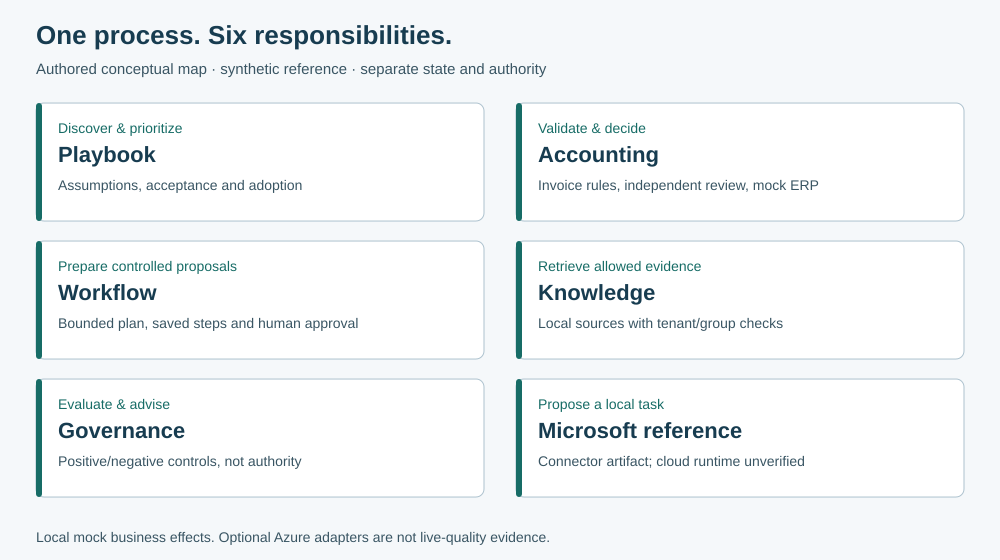
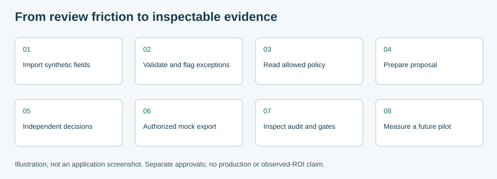
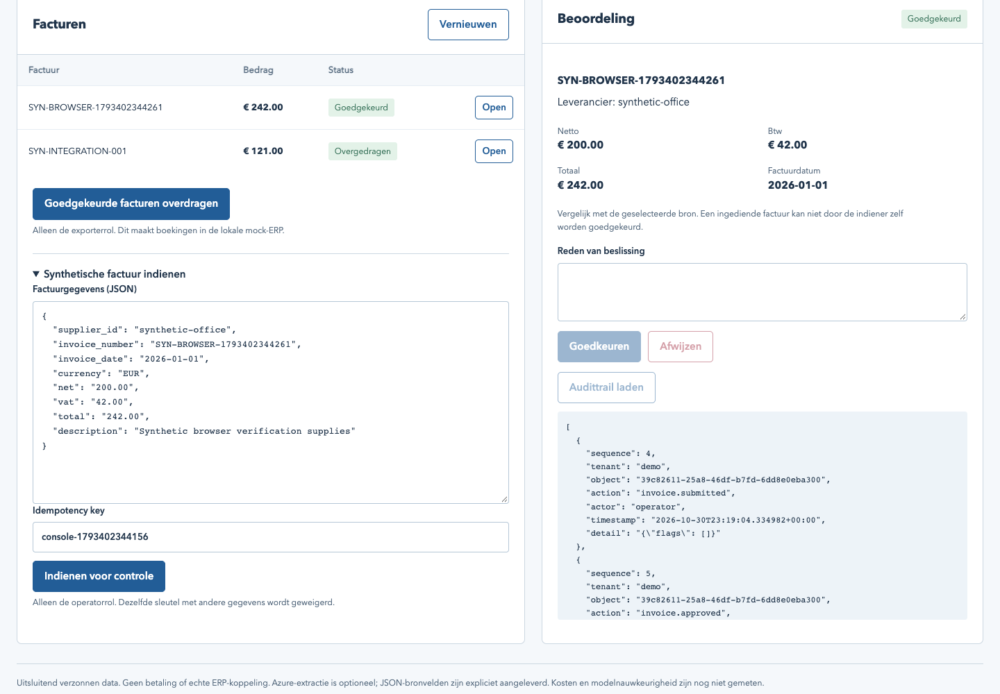
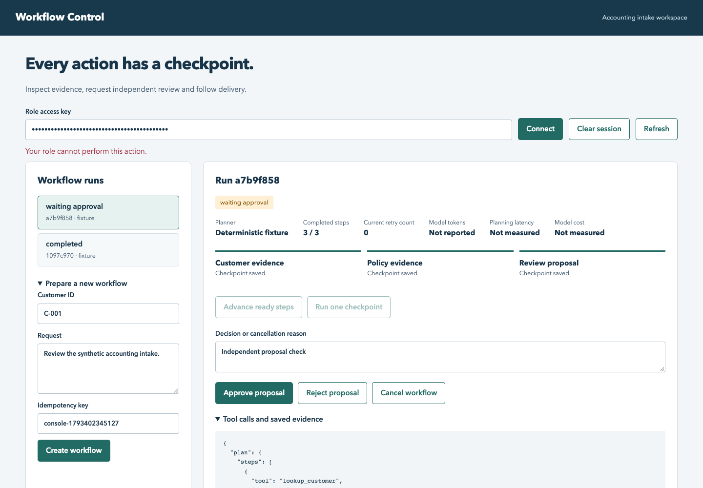
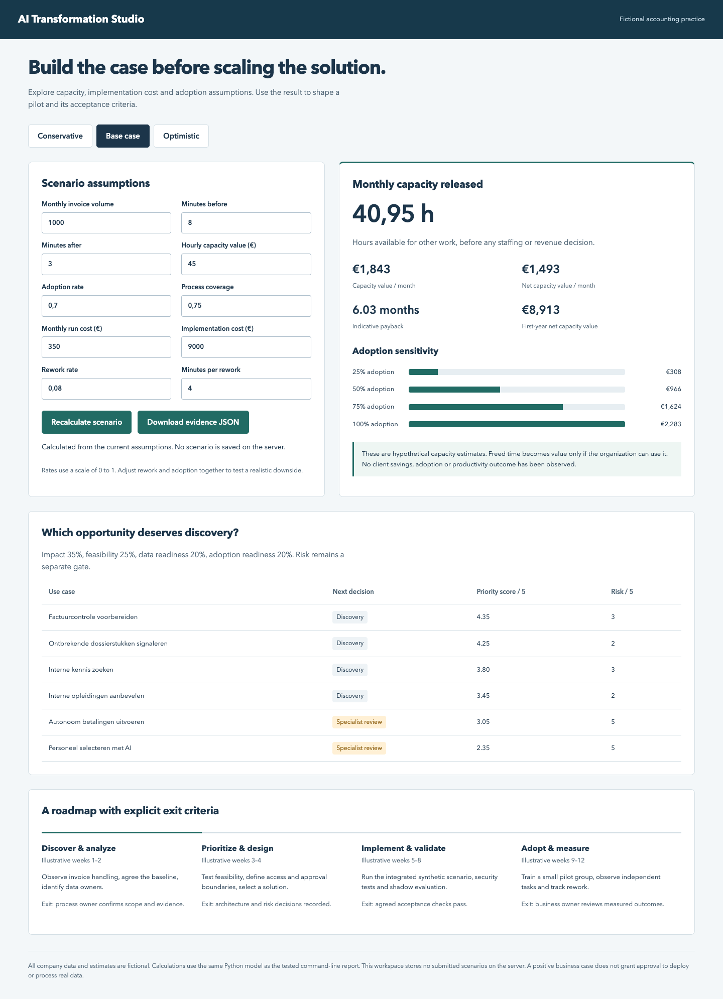

# Visual index and authentic screenshot gallery

Text equivalent: Playbook frames process and adoption; Accounting validates/reviews/exports locally; Workflow prepares controlled proposals; Knowledge retrieves allowed sources; Governance observes/advises; Microsoft reference separates proposal/review/execution. Each has separate authority. Optional cloud adapters are unverified. The detailed [architecture](../../SHOWCASE.md#architecture) retains actual integration directions.

Text equivalent: import explicit fields → validate → retrieve policy → prepare a proposal → obtain independent decisions → authorized local mock export → inspect audit/evaluations → define a future pilot. This is a demonstration narrative, not a claim that every transition is an automatic service call.

## Implemented interfaces

Accounting: actual implemented UI, synthetic data. JSON import supplies explicit fields; this screenshot does not establish OCR.

Workflow: actual implemented UI in fixture mode. Tool receipts and persisted state are visible; the image is not evidence of a new model call.

Playbook: actual implemented calculator. Capacity estimates are hypothetical, not observed client savings.

All three PNGs are unchanged copies of existing authored screenshots. [Source paths, labels and SHA-256](provenance.json) support provenance. The SVGs are new explanatory illustrations, not screenshots. Captions and this text are necessary when reusing them; do not turn them into fake live-product mockups.

For mobile layouts, allow images to scale without fixed heights and retain readable text alternatives. Do not require users to read tiny diagram text: the adjacent summary/list contains the same information. No new fonts, stock art, tracking or icon dependency is needed.
