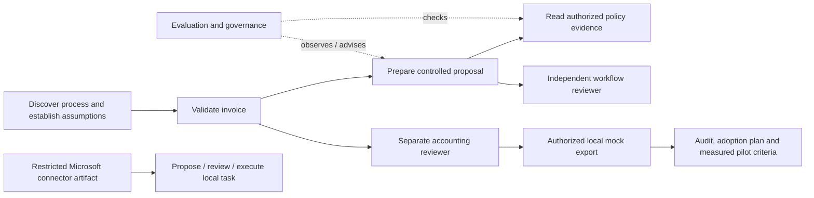

# One consulting case, six engineering responsibilities

## Recruiter overview — 60 seconds

This portfolio follows a fictional accounting practice improving invoice review. It connects a business case to working software: invoice validation and independent approval, controlled AI tool proposals, permission-filtered knowledge, evaluation gates and a Microsoft connector artifact. The consulting playbook supplies the process, adoption plan and assumptions behind the technical work.

The strongest demonstration is an actual local HTTP scenario across the applications, available without a model and with genuine local Qwen tool calling. Data, reviewers and business effects are synthetic. The project demonstrates inspectable engineering decisions; it does not establish professional client experience, measured client savings or assessed personal competence.

## Technical architect overview

Accounting owns invoice state and export authority. Workflow owns a durable proposal state machine. RAG owns knowledge access before ranking. Governance checks outputs and advises on controls; it never grants execution authority. Automation exposes a narrow proposal/status connector and separates reviewer/executor identities. Playbook owns the optional integration runner and the business/adoption case.

The systems communicate through existing HTTP contracts. They do not share tables, transactions or runtime packages. SQLite transactions, idempotency keys and lease fencing make the single-host demonstration reproducible. A real external sink needs its own idempotency and reconciliation contract. The planner proposes three validated calls; it is not an adaptive multi-agent system. Framework migration was deferred until a requirement justifies it.

## AI consultant overview

Discover a process before choosing AI. Observe transcription, policy lookup, handoffs and exceptions. Decide which steps are deterministic, which benefit from a model, which require human authority and how users will detect a bad suggestion. Agree acceptance and stop criteria with the process owner. Compare observed active handling time and rework with the declared baseline; do not equate released capacity with cash savings.

The synthetic business case is a decision aid, not a client result. The calculator exposes adoption, coverage, cost and rework sensitivity. Governance, training and benefits measurement continue after technical tests pass.

## Short demonstration — five minutes

1. **Problem and assumptions (45 seconds):** open the consulting workspace, show the fictional invoice process and explain that capacity figures are hypothetical. Set adoption to zero and show that payback disappears.
2. **Business workflow (90 seconds):** use accounting source import and submit a synthetic invoice. Show validation, attempted operator approval denial, separate reviewer approval, export queue and local mock ERP export. Repeat export and inspect the audit.
3. **Controlled AI (75 seconds):** inspect a workflow plan, actual invoice/policy tool receipts and approval wait. Explain the fixture label or explicitly show the recorded genuine local-model run. A model never receives export credentials.
4. **Knowledge and evaluation (60 seconds):** search the policy with a finance identity, then request the HR canary and show abstention. Run good/unsafe fixture controls and explain what their gates actually test.
5. **Microsoft and limitations (30 seconds):** inspect the real solution ZIP/connector operation allowlist. State that artifact acceptance was tested previously; active Copilot/flow runtime and Azure quality remain unverified.

Use the interactive mode in [the integration guide](../../integration/README.md). Run with fresh temporary state for a predictable demonstration. Scripted identities are not a replacement for a live UAT exercise with users.

## Extended technical walkthrough — 20 minutes

| Time | Inspect | Explain / demonstrate |
|---|---|---|
| 0–3 min | `consulting/business_case.py`, scenario data | Formula, assumptions, negative case and risk separate from priority score |
| 3–6 min | Accounting `models.py`, `store.py`, `api.py` | Exact amounts, duplicate keys, version check, independent approval and atomic outbox |
| 6–10 min | Workflow `models.py`, `engine.py`, `store.py`, `integrations.py` | Scope validation, persisted receipts, bounded retries, lease ownership and cancellation race |
| 10–13 min | RAG `core.py`, `azure.py`, `evaluate.py` | ACL before lexical statistics, optional hybrid adapter, citations and ranking metric limitations |
| 13–16 min | Evals `engine.py`, `portfolio.py` | Deterministic versus semantic evaluation, critical gates and observation without effects |
| 16–18 min | Automation `api.py`, connector and solution | Proposal/status-only operations, separate review/execution, reserved example backend |
| 18–20 min | Release evidence, CI and learning exercises | Fresh wheel installation, negative tests, remaining hosted/cloud validation and personal ownership |

## Architecture explanation

Only the locally executed API interactions are represented as working application integration. Microsoft artifact acceptance does not prove the connector is actively calling the local task service. Azure infrastructure is a documented optional path, not a deployed dependency.

## Recommended portfolio order

Use this repository as the entry point. Show accounting first for stakeholder clarity, workflow second for engineering depth, then governance and knowledge for reliability/security. Show the Microsoft connector artifact with its exact verification boundary. Link all repositories as complementary parts of one consulting case. Preserve their independent quick starts and licenses.
